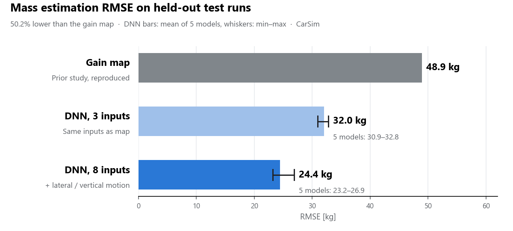

# VSCL · 차량 질량추정

물리 기반 차량 질량추정기에서 **사람이 표로 정해 둔 보정값을 DNN이 주행 상태에 맞춰 정하도록 바꾼** 학부연구입니다.

**한국기술교육대학교 차량 시스템·제어 연구실(VSCL) 학부연구생 · 2026.08 ~ 현재** · CarSim / Python / PyTorch

- **담당:** 기존 추정기 재현, 주행 데이터 설계, DNN 학습과 비교를 맡았습니다.
- **문제 → 판단:** 기존 보정 맵은 선회와 노면 기복을 구분하지 못했습니다. 그래서 차체의 횡·수직 운동 신호를 DNN 입력에 더했습니다.
- **최종 평가:** 학습과 모델 선택에 쓰지 않은 주행에서 질량추정 오차(RMSE)를 기존 맵보다 **50.2%** 낮췄습니다(**48.9 → 24.4 kg**).

[English](#english-overview)

## 무엇을 바꿨는가

**1. 추정기와 센서 신호부터 확인**

AI 학습에 앞서 추정기의 물리 모델과 센서 신호의 관계를 먼저 확인했습니다. CarSim의 피치·롤 응답을 분석해 가속도 보정을 종·횡·수직 방향으로 확장했고, 센서 신호의 의미와 단위, 부호를 확인해 추정기 입력을 구성했습니다.

**2. 주행 조건 설계와 데이터 분리**

경사, 선회, 차선 변경, 정차·재출발을 포함한 주행 조건을 설계했습니다. 데이터는 처음부터 학습·검증·최종 평가용으로 나눴습니다.

**3. 보정 맵 → DNN, 그리고 입력 추가**

기존 추정기를 재현한 뒤 세 가지를 비교했습니다.

| 방식 | 입력 | 최종 평가 RMSE |
| --- | --- | ---: |
| 기존 보정 맵 (기존 논문 방식 재현) | 기준 | 48.9 kg |
| DNN, 입력 3개 | 맵과 같은 입력 | 32.0 kg |
| DNN, 입력 8개 | + 차체 횡·수직 운동 신호 | **24.4 kg** |

조건별로 오차를 나눠 보니, 맵은 노면 기복과 복합 주행에서 약했습니다. 그래서 이를 반영할 수 있도록 횡·수직 운동 신호를 입력에 더했습니다.

## 검증 방법

- 검증 주행에서 고른 모델을 바꾸지 않고 그대로 최종 평가에 적용했습니다.
- 초기값이 다른 5개 모델에서 모두 8입력이 3입력보다 오차가 작았습니다(23.2~26.9 kg vs 30.9~32.8 kg, 두 범위가 겹치지 않음).
- RMSE는 초기 추정값 1,600 kg에서 시작해, 실제 질량 4가지의 최종 평가 주행에서 계산했습니다. 모델·질량·주행 조건에 같은 가중치를 두고 평균했습니다.
- Baseline은 기존 논문의 보정 맵을 같은 주행 데이터에 재현해 평가한 값입니다. 논문에 실린 수치와는 별개입니다.
- 반복 계산 병목을 고쳐 학습 실행 속도를 6.23배 높였습니다. 기준 구현을 먼저 만들어 두고, 빠르게 바꾼 뒤에도 결과가 같은지 대조했습니다.

## 공개 범위

연구가 진행 중이고 논문 원고도 공개 전이라, 이 폴더에는 **결과 수치와 설명만** 담았습니다. 연구 코드, 학습 데이터, 원고는 포함하지 않았습니다. 그래프는 위 표의 수치로 다시 그린 것입니다. 모든 결과는 CarSim 시뮬레이션에서 얻었고, 실차 시험은 하지 않았습니다.

## English overview

Replacing a hand-tuned correction map with a DNN for vehicle mass estimation

Undergraduate research at the Vehicle Systems and Control Laboratory (VSCL), KOREATECH, since August 2026.

I reproduced a physics-based vehicle mass estimator in Python using CarSim data and extended its tilt correction to the longitudinal, lateral and vertical axes after checking pitch and roll responses. I designed driving scenarios (grades, cornering, lane changes, stop-and-go) and split the data into training, validation and final test sets from the start.

I replaced the baseline's hand-tuned correction map with a DNN trained in PyTorch. Because the map could not distinguish cornering and road undulation, I added the vehicle body's lateral and vertical motion signals as inputs. On test drives kept out of training and model selection, RMSE dropped by 50.2% compared with the map (48.9 → 24.4 kg). A DNN using the same three inputs as the map reached 32.0 kg. Across five models with different initializations, the eight-input DNN was better in every case (23.2–26.9 vs 30.9–32.8 kg).

Research code, data and the manuscript are not included; this page shows results only. All results come from CarSim simulations, not vehicle tests.

[다른 프로젝트](../../README.md)
